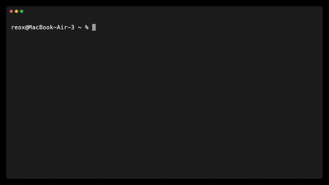

# Running LLMs and an image model on the Zhouyi NPU with tinygrad


*Ternary Bonsai 2 27B on the board's NPU, served over the Ollama API ([how](bonsai2-27b/README.md#serve-openai--and-ollama-compatible-api)) and asked with `ollama run --verbose` from a Mac: 208 tokens at 4.8 tok/s.*



*Gemma 4 E2B on the board's NPU, served over the Ollama API ([how](gemma4/README.md#serve-openai--and-ollama-compatible-api)) and asked with `ollama run --verbose` from a Mac: 230 tokens at 23 tok/s with speculative decoding.*

Worked examples that run real models on the Arm China Zhouyi X2 NPU of the CIX P1 (CD8180), as found on the Radxa Orion O6N,
through the `ZHOUYI` backend of [tinygrad](https://github.com/Reonarudo/tinygrad/tree/zhouyi). The backend is included as the
`tinygrad/` submodule (branch `zhouyi`). Each example downloads its model, packs the weights into the layout the NPU streams,
and runs it; the text models can also be served over the OpenAI and Ollama APIs.

## Examples

| example | what it does | speed on the board |
| --- | --- | --- |
| [qwen3.8-27b/](qwen3.8-27b/) | Qwen3.8-27B text generation from its FP8 checkpoint: all 64 layers, the head and the multi-token-prediction (MTP) draft head on the NPU, weights mapped zero-copy from RAM | 0.76 tok/s plain; **~2.2 tok/s** with speculative decoding on three prompts (3.6 on code, 2.9 on step-by-step reasoning, 1.35 on prose; `QWEN_SPEC=6`), same tokens |
| [bonsai2-27b/](bonsai2-27b/) | PrismML's Ternary Bonsai 2 27B (Qwen3.8-27B with ternary weights) from its 5.9 GB GGUF: all 64 layers and the head on a ternary GEMM, speculative decoding with Qwen3.8-27B's MTP layer as the draft; an OpenAI-compatible server (`bonsai2_serve.py`); the 2B / 4B / 9B sizes on the same runtime with drafters of their own size | 27B 2.1 tok/s plain, **~6.2 tok/s** speculative (~7.5 on code); 9B 4.5 -> **9.2-10.7**; 4B 6.9 -> **16-24**; 2B 10.0 -> **28-35**; same tokens throughout; `bonsai2_batch.py`: N requests a step on the 2B with batched mixer kernels, 19-25 -> 64-84 (4 users) -> **94-112 tok/s** aggregate (8 users, four layers a job), each user plain greedy |
| [ornith-9b/](ornith-9b/) | Ornith 1.0 9B (Qwen3.5 architecture) from its GGUF Q8_0 checkpoint, on the same modules as qwen3.8-27b; speculative decoding with Qwen3.5-9B's MTP head as the draft | 2.1 tok/s plain; **~6.8 tok/s** with speculative decoding on three prompts (8.1-8.4 on code and step-by-step reasoning), same tokens |
| [qwen3-30b-a3b/](qwen3-30b-a3b/) | Qwen3-30B-A3B (128-expert MoE, 3.3 B active) from the Radxa forum's benchmark GGUF, Q4_K_M: all 48 layers, the routing and the head on the NPU in the checkpoint's own Q4_K / Q6_K; prompts in 512-token chunks with the experts grouped by token, the attention on the matrix unit; decode on integer dot products (`qdot`) over the same streams, the Q6_K linears and the attention from decode-only 6.6- / 4.75-bit copies | **prefill 62.4 tok/s** (llama.cpp on the same board's CPU: 31.3); decode 9.6 tok/s (CPU: 17.4) |
| [gemma4/](gemma4/) | Google's Gemma 4 E2B and E4B from their Q8_0 GGUFs: every layer (sliding-window and global attention, per-layer embeddings, shared KV caches) and the head with its top-1 on the NPU, the prompt 8 tokens a pass, speculative decoding with Gemma 4's MTP draft head | E2B 8.4 tok/s plain, **~22 tok/s** with speculative decoding (7 drafts a pass; ~13.6 on prose); E4B 4.3 and **11.0 tok/s**; same tokens; prefill 46 tok/s on a 1074-token prompt |
| [qwen35moe/](qwen35moe/) | Qwen3.6-35B-A3B (and Qwen3.5-35B-A3B; 256-expert MoE with a shared expert, 3 B active, Gated DeltaNet + full attention every 4th layer) from the UD-Q4_K_M GGUF, nothing requantised (a native 5-bit stream for its Q5_K experts): all 40 layers, the routing and the head on the NPU, one kernel graph a layer; `qwen36_spec.py`: speculative decoding on the Qwen3.8 runtime with the model's own MTP layer (a MoE layer, fetched from the HF checkpoint) | **4.7 tok/s** plain decode, llama.cpp's tokens; prefill 3.3 tok/s (the decode path a token); speculative **5.5-8.5 tok/s** (the same answers), prefill 11 tok/s through its verify path |
| [ringmini/](ringmini/) | inclusionAI's Ring-mini-2.0 (256-expert MoE, ~1.4 B active, grouped sigmoid router) from its Q4_K_M GGUF: an all-GEMV layer, the routing on the device, one kernel graph a layer | **12.5 tok/s** decode, the reference's tokens; prefill 9.1 tok/s |
| [lfm25/](lfm25/) | Liquid's LFM2.5-24B-A2B (short-conv + attention hybrid, 64 experts top 4, ~2.2 B active) from its Q4_K_M GGUF: the conv as one row kernel with its state on the device, the dense 11776-wide FFN on the matrix unit | **9.2 tok/s** decode, llama.cpp's tokens; prefill 5.1 tok/s |
| [gptoss/](gptoss/) | OpenAI's gpt-oss-20b (MXFP4 experts, attention sinks, sliding windows, YaRN) from its GGUF: the experts repacked losslessly into a 5.75-bit integer stream (the FP4 decoder ran at 5 GB/s), the library's sinks attention (`seqmix/attn.py`) | **4.9 tok/s** decode, llama.cpp's tokens but one near tie in 24; prefill 3.3 tok/s |
| [gemma26/](gemma26/) | Google's Gemma 4 26B-A4B (128 experts top 8 beside a dense FFN, local / global attention with head dimension 256 / 512) from unsloth's UD-Q4_K_M GGUF: a new exact 6-bit stream for its Q5_1 experts, the gemma4 example's attention kernels | **3.7 tok/s** decode, the reference's tokens; prefill 2.3 tok/s |
| [seqmix/](seqmix/) | the sequence-mixer kernel library the ports draw on: Mamba-2, MLA, KDA, CCA, attention with sinks and windows, the device routing and the row kernels, each with a numpy contract and a simulator gate | per layer on the board: Mamba-2 532 us, MLA 447, KDA 253, CCA 101, sinks attention 147 / 262, routing 69 |
| [ideogram4/](ideogram4/) | Ideogram 4 text-to-image at full precision: both DiT transformers and the VAE decoder on the NPU | ~167 s a sampling step at 1024 x 1024 (12 steps with `V4_TURBO_12`, ~33 min an image) |

Speeds are measured on the board with the NPU clocks at their defaults; text-generation speed depends on the prompt (code and
other predictable text drafts better).

- **Qwen3.8-27B / Ornith:** the host only tokenises, embeds and picks tokens. Decoding is bound by streaming the weights through
  the NPU's ~24 GB/s DDR port (27 GB a pass for the 27B), so speculative decoding verifies up to 6 tokens per pass through the
  weights. The output is identical to plain greedy decoding by construction.
- **Bonsai 2 27B:** the ternary weights cut a token's weight traffic to ~8 GB, but expanding them makes the GEMM compute-bound, so
  a verify pass is cheap up to 4 rows and speculative decoding drafts at most 3 tokens.
- **Qwen3-30B-A3B:** a prompt chunk of 512 tokens reads each expert about twice and is GEMMs on the matrix unit, so prefill beats the
  CPU; a decode token reads ~2.1 GB through the NPU's 24 GB/s port (~10.8 tok/s at best with the prefill's streams), so decode stays
  the CPU's -- its GEMVs run as integer dot products at the port's rate, 9.6 tok/s.
- **Gemma 4:** a token streams ~2.4 GB of weights on E2B (~5 GB on E4B), so plain decoding is bound near 10 tok/s (E4B: 5); a
  verify pass of up to 8 rows costs ~1.1 plain steps, and the model's own MTP draft head proposes up to 7 tokens a pass.
- **Ideogram 4:** the text encoder runs on the host CPU (~2.5 min a prompt); everything after it runs on the NPU.

## Small MoE models side by side

The five models of the small-MoE survey's NPU-fit ranking run on the same recipe: the checkpoint's own quantisation streamed
as integer dot products on the TECs (nothing requantised), the weights pinned in RAM and mapped two layers at a time, one kernel graph a
layer with the expert routing on the device, and no host sync inside a token. Board: Radxa Orion O6N (Zhouyi X2, 3 cores x 4 TECs, one
~23 GB/s DDR port, 29 GB RAM), greedy decoding, the prompt through the decode path a token. "Reference" is the numpy reference built
from the GGUF, which reproduces llama.cpp's greedy output where that was checked.

| model | active / total params | resident weights | decode tok/s | prefill tok/s | byte floor at 23 GB/s | layer gate (worst rel. err.) | output |
| --- | --- | --- | --- | --- | --- | --- | --- |
| [Ring-mini-2.0](ringmini/) | ~1.4 B / 16 B | 11 GB | **12.5** | 9.1 | ~31 tok/s | 8e-4 | = reference |
| [LFM2.5-24B-A2B](lfm25/) | ~2.2 B / 24 B | 16.0 GB | **9.2** | 5.1 | ~21 | 1.1e-3 | = reference |
| [gpt-oss-20b](gptoss/) | ~3.6 B / 21 B | 14.6 GB | **4.9** | 3.3 | ~9.5 | 1.3e-4 | 23 of 24 ids (one near tie) |
| [Qwen3.6-35B-A3B](qwen35moe/) | ~3 B / 35 B | 23.6 GB | **4.7** (speculative 5.5-8.5) | 3.3 (11 through the verify path) | ~8.8 | 1.05e-3 (all 40 layers) | = llama.cpp |
| [Gemma 4 26B-A4B](gemma26/) | ~4 B / 26 B | 18.1 GB | **3.7** | 2.3 | ~6.8 | 2.2e-4 | = reference |

A token's time is close to `bytes / 23 GB/s + ~2.3 ms x layers`: the weights through the DDR port, plus a fixed cost a layer (20-30
kernel launches, the fp32 router GEMV, the plain-load row kernels). Ring is fastest on both counts: the fewest active parameters and the
fewest layers (20). The byte floor is what the format allows; the gap to it is the fixed cost, which fusing the layer's kernels and a
DMA router GEMV would cut. Qwen3.6 has a speculative path (`qwen35moe/qwen36_spec.py`: 5.5-8.5 tok/s); Ring-mini and the others have no draft head in their
checkpoints. The dense examples above show what a drafter adds (Gemma 4 E2B 8.4 -> 22 tok/s, Bonsai 2 2B 10 -> 24-29).

For comparison, the dense models on the same board: Bonsai 2 27B (ternary, ~8 GB a token) 2.1 tok/s plain / 6.2 speculative;
Qwen3-30B-A3B (MoE, Q4_K_M) 9.6 tok/s decode.

## Getting started

```sh
git clone --recurse-submodules <repository-url>
cd example-tinygrad-npu-uses
pip install -r requirements.txt
```

- A Radxa Orion O6N (or another CIX P1 board) running Linux with the Zhouyi NPU kernel driver (details below).
- **Python 3.12 or newer** with `numpy` and `tokenizers` (`pip install -r requirements.txt`). tinygrad comes from the submodule;
  nothing else is installed from this repository.
- Disk and RAM for the model you run (below, and in each example's README).

### Requirements on the board

More detail in [`tinygrad/extra/zhouyi/README.md`](tinygrad/extra/zhouyi/README.md).

- **The Zhouyi NPU kernel driver with its UAPI header `armchina_aipu.h`.** On first use the backend generates its bindings from
  that header. It looks in the driver's usual install locations; set `ZHOUYI_AIPU_HEADER=/path/to/armchina_aipu.h` otherwise.
- **libclang**, for that one-time generation. Distributions that ship only a versioned library (e.g. Debian / Ubuntu
  `libclang-NN-dev`) need `LIBCLANG_PATH=/usr/lib/llvm-NN/lib/libclang-NN.so` for the first run.
- **The vendor's AIPU compiler toolchain library** (`libaiputoolchain.so`). Default location `/usr/share/cix/lib/onnxruntime`;
  set `ZHOUYI_TOOLCHAIN_DIR` otherwise.
- **For the 27B models and Gemma 4:** the driver's zero-copy weight buffers (the WBUF / SLOT ioctls). Without them the weights
  are copied every token (~2-3 s a token on the 27B).
- **NPU clocks at their defaults** (`npuclk` 1.2 GHz, `npu_memclk` 750 MHz) to reproduce the numbers above.
- **Disk:** Qwen3-30B-A3B 17.3 GB of checkpoint + 26 GB packed (and ~27 GB of free RAM for its pinned weights); Qwen3.8 about 27 GB of checkpoint + 27 GB of packed layers; Bonsai 2 about 6.4 GB of downloads + 8.7 GB packed; Gemma 4 E2B 5.0 GB + 2.4 GB packed; Ideogram 4 about 45 GB, plus ~16 GB of repacked panels
  (set `P48_DIR` / `W13I_DIR` to a disk with room).

### First run

Each example's README walks through download, pack and run. For example, Bonsai 2 27B:

```sh
cd bonsai2-27b
export BONSAI_DIR=/mnt/ssd/bonsai2 BONSAI_GGUF=/mnt/ssd/bonsai2/Ternary-Bonsai-2-27B-PTQ1_0.gguf QWEN_NPU=/mnt/ssd/bonsai2-npu
bash download.sh
python3 bonsai2_pack.py && python3 bonsai2_pack.py --head && python3 bonsai2_pack.py --fuse
python3 bonsai2_pack.py --mtp $BONSAI_DIR/qwen3.8-27b-mtp
python3 bonsai2_generate.py "Write a Python function that returns the n-th Fibonacci number." --max-new 120
```

### Serving

`bonsai2-27b/bonsai2_serve.py` (and the generic `qwen3.8-27b/qwen38_serve.py`) keeps the model loaded and serves the OpenAI API
(`/v1/chat/completions`, `/v1/completions`, `/v1/models`) and Ollama's API (`/api/chat`, `/api/generate`, `/api/tags`, ...), so
the Ollama CLI, Ollama GUI apps and OpenAI clients can use the board. Starting it, running it as a systemd service and the
client set-up are in [bonsai2-27b/README.md](bonsai2-27b/README.md#serve-openai--and-ollama-compatible-api).

### Troubleshooting

| message | fix |
| --- | --- |
| `the Zhouyi KMD's UAPI header armchina_aipu.h was not found` | install the NPU driver's headers, or set `ZHOUYI_AIPU_HEADER` |
| `failed to load library libclang: try setting LIBCLANG_PATH?` | set `LIBCLANG_PATH` to your versioned `libclang-NN.so` for the first run |
| an error about the AIPU toolchain library | install the vendor toolchain package, or set `ZHOUYI_TOOLCHAIN_DIR` |
| `QWEN_CPU_LATENCY: no PM QoS request` | optional: allow access to `/dev/cpu_dma_latency` ([how](bonsai2-27b/README.md#the-cpu-latency-request)) |
| a job reports `EXCEPTION` after ~30 s | the NPU did not finish a job; `ZHOUYI_HANG_ID=1` names the kernel, its tasks and buffers |

## Layout

Each example is a folder with a `README.md` (prerequisites, stages, expected numbers and timings), its scripts and, where the
model is fetched from Hugging Face, a `download.sh`. Ideogram 4 has a `run.sh` for the whole pipeline. The `check/` folders hold
the correctness checks each README describes.

Model-specific NPU kernels live with their model (e.g. `qwen3.8-27b/qwen38_kernels.py`, `ideogram4/ideogram4_vec.py`). The
generic backend lives in the submodule: the device under `tinygrad/runtime/`, and the custom ops and generic hand-written
kernels under `extra/zhouyi/`. The small `zy.py` next to each example resolves them.

## Licence

The code in this repository is free software under the **GNU Affero General Public License v3.0 or later**
([LICENSE](LICENSE)), with an additional term under its section 7(b) requiring attribution ([NOTICE](NOTICE)):

- You may use, study, modify and share it. If you distribute a modified version, or let others use one over a network (for
  example by running a modified `bonsai2_serve.py` as a service), you must make its source available under the same licence.
- Copies and derived works must keep the attribution "Based on tinygrad-npu-examples by Leonardo Marques
  (https://github.com/Reonarudo/tinygrad-npu-examples)" in their source and wherever they show credits or legal notices.

Not covered by it: tinygrad, a git submodule, and its Zhouyi backend are under tinygrad's MIT licence. This repository bundles
no third-party code: the NPU driver, the vendor toolchain library, libclang and the Python packages are installed by you from
their own sources. The model weights are not included: you download them from Hugging Face (`download.sh` where the example has
one) under each model's own licence (Qwen3.8-27B and Ternary Bonsai 2 27B: Apache-2.0; Gemma 4: see its model card; Ideogram 4:
gated, accept its licence on Hugging Face first).

## Configuration: Qwen3.8-27B, Bonsai 2 and Ornith

The three text examples run the same modules (`bonsai2-27b/` sets `QWEN_MODEL=bonsai2-27b`, `ornith-9b/` sets
`QWEN_MODEL=ornith-9b`). All settings are environment variables; the defaults are the tuned ones. Bonsai 2's own defaults are in
[its README](bonsai2-27b/README.md#settings).

### Common settings

| variable | default | what it does |
| --- | --- | --- |
| `QWEN_SPEC` | `0` on qwen3.8-27b (plain decoding), `8` on ornith-9b (the leaf tree) | rows of a verify pass (1 + drafts); `0` decodes plainly. `6` is the measured setting on the 27B (`8` measured +10 % with the deferred-commit kernel) |
| `QWEN_DIR` | `/mnt/ssd/qwen3.8-27b-fp8` (Ornith: `ORNITH_GGUF`) | the checkpoint. Set it to your path |
| `QWEN_NPU` | `/mnt/ssd/qwen3.8-27b-npu-s1` (Ornith: `/mnt/ssd/ornith-9b-npu`) | the packed cache written by the pack script. Set it to your path. For Ornith, the speeds above were measured on the default (exact) cache; an `ornith_pack.py --q8f` cache now measures 2-3 % slower |
| `ORNITH_GGUF`, `ORNITH_MTP` | `/mnt/ssd/models/ornith-1.0-9b-Q8_0.gguf`, `/mnt/ssd/qbench/models/Qwen_Qwen3.5-9B-bf16.gguf` | Ornith's checkpoint and the Qwen3.5-9B GGUF its draft head comes from. Set them to your paths |
| `QWEN_TOK` | the checkpoint folder (Ornith: the cache) | where `tokenizer.json` is |
| `QWEN_PIN_GB` | `24` (Ornith: `12`) | GB of layers pinned in RAM |
| `QWEN_CPUS` | `auto` | run the host on the CPU that takes the NPU's interrupt (and one other core of its speed); `off`, or a list such as `0,1` |
| `QWEN_CPU_LATENCY` | `0` | the CPU-latency request (µs) held on `/dev/cpu_dma_latency` while the process runs; `off`: none |

### Speculative decoding

| variable | default | what it does |
| --- | --- | --- |
| `QWEN_DRAFT` | `mtp` | the drafter: the checkpoint's MTP head, or `none` (verify path without drafts) |
| `QWEN_DRAFT_TAU` | `0.6` | keep drafting while the draft head's probability is at least tau; `0` always drafts `QWEN_DRAFT_MAX` |
| `QWEN_DRAFT_MAX` | `QWEN_SPEC - 1` (Ornith: `5`) | drafts per pass at most |
| `QWEN_DRAFT_PARTS` | `2,thresh:25` on qwen3.8-27b, `2` on Ornith | `<n>[,thresh:<x>]`: the draft head reads the lm head's first n column parts; with `thresh:<x>` it reads parts after the first only when the first part's top logit is at most x |
| `QWEN_SPEC_GEOS` | `3,4,6` | verify geometries (row counts) captured; a pass rounds up to the next one |
| `QWEN_GDN_FAST` | `asm` | the deferred-commit DeltaNet verify kernel (`gdn_fast_src`, every model, up to 8 rows); `c` its compiler-scheduled sweeps; `off` the per-token state banks and the full commit (`QWEN_GDN_DEFER=0` the same) |
| `QWEN_SPEC_TREE` | `off` (Bonsai 2, Ornith: `leaf`) | `leaf`: the chain plus the drafts' rank-2/3 candidates in the spare rows (any model). `rescue2`: every pass verifies 8 rows, the 5-draft chain plus 2 "rescue" rows holding the draft head's second-choice token at the two least confident positions (`fixed:<j1,j2>` for fixed positions). About +1 % on average; see [qwen3.8-27b/README.md](qwen3.8-27b/README.md) |
| `QWEN_SPEC_WARM` | `1` | prepare every verify and draft geometry before the first token |
| `QWEN_SPEC_LOG` | unset | a `.jsonl` path for per-pass telemetry (drafts, acceptance, times, output ids) |
| `QWEN_HEAD_TOP3` | `0` | also log the draft head's top-3 tokens (drafts unchanged) |

### Memory options

| variable | default | what it does |
| --- | --- | --- |
| `QWEN_ZC` | `1` | zero-copy weights; `0` copies each layer (needed when the driver lacks the WBUF / SLOT ioctls) |
| `QWEN_NOPREFETCH` | unset | no read-ahead of layers that are not pinned in RAM |
| `QWEN_PREFILL` | unset | `chunked`: prefill the FP8 model through the verify path (Ornith always does; the server does by default) |

### Alternative kernel paths

The defaults are the fastest paths and the only ones recommended. The alternatives below are kept to compare against and to
narrow down a problem; they produce the same tokens.

| variable | default | alternatives | note |
| --- | --- | --- | --- |
| `QWEN_GDN_PREP` | `dma` | `fast`, `cached`, `dma-lsarr` | how the verify pass's DeltaNet kernel stages its rows. `fast` and `cached` read the rows through the cache; they are the older paths and can stall the NPU under some memory placements |
| `QWEN_ATTN_PREFILL` | `csrc` | `none` | the full-attention prefill (FP8 model). `none` uses tinygrad's generated kernels, the older path, which can stall the NPU |
| `QWEN_FUSE` | `1` | `0` | `0` runs the same-input projections as separate GEMMs (for a cache packed without `--fuse`) |
| `QWEN_ATTN` | `split` | `decm` | the verify pass's attention as one kernel instead of two |
| `QWEN_GDN_TOK` | `3` | `1`, `2` | earlier variants of the one-token DeltaNet kernel |
| `QWEN_RMS_DMA` | `1` | `0` | RMSNorm rows read through the cache instead of streamed by DMA |
| `QWEN_SMALL_DMA` | `1` | `had`, `0` | the rows-mode layout kernels (residual add, C unpack, SwiGLU, un-normed A, the head's top-1) streamed by DMA in every model's verify / draft / decode geometries. `had` limits that to Bonsai 2's rotated-input geometries (the previous default: Ornith, Qwen3.8 and Bonsai's drafter on the plain-load kernels); `0` uses the plain-load kernels everywhere |
| `QWEN_HEAD` | `fp8` when packed, else `fp16` | `fp16`, `both` | the lm head for plain decoding; `both` runs both and compares |

### Diagnostics

| variable | what it does |
| --- | --- |
| `QWEN_DEBUG`, `QWEN_PA`, `QWEN_DUMP_HIDDEN`, `GDN_TOKM_DIAG` | debug prints, buffer addresses, hidden-state dumps, the DeltaNet kernel's diagnostic modes |
| `QWEN_SHARDS`, `QWEN_TMAX`, `QWEN_PROF_POS` | used by the `check/` scripts and diagnostics only (reference shards, a cache length and position) |

### Backend settings

The backend's variables are documented in [`tinygrad/extra/zhouyi/README.md`](tinygrad/extra/zhouyi/README.md). The ones a
user is most likely to need:

| variable | default | what it does |
| --- | --- | --- |
| `ZHOUYI_AIPU_HEADER` | the driver's install locations | the KMD header the bindings are generated from |
| `ZHOUYI_TOOLCHAIN_DIR` | `/usr/share/cix/lib/onnxruntime` | where `libaiputoolchain.so` is |
| `ZHOUYI_HANG_ID` | `0` | `1`: if a job never finishes, report the kernel, its tasks and buffers; `2`: also per-task progress stamps; `1:<path>` / `2:<path>`: also append each report to a file |
| `ZHOUYI_CHAIN_MAX` | `8` | kernel launches fused into one NPU job; `1` runs each launch as its own job (with `ZHOUYI_HANG_ID`, pins a problem to one kernel) |
| `ZHOUYI_GM` | `0` | `1`: GEMMs stage through the cluster's shared GM memory (Ideogram 4 sets it) |
| `ZHOUYI_CORES` | `3` | NPU cores a launch may use |

The packed caches record their weight-scale layout themselves (a `scales` marker file), so no setting is needed for it; the
loader refuses a cache whose layout does not match.
